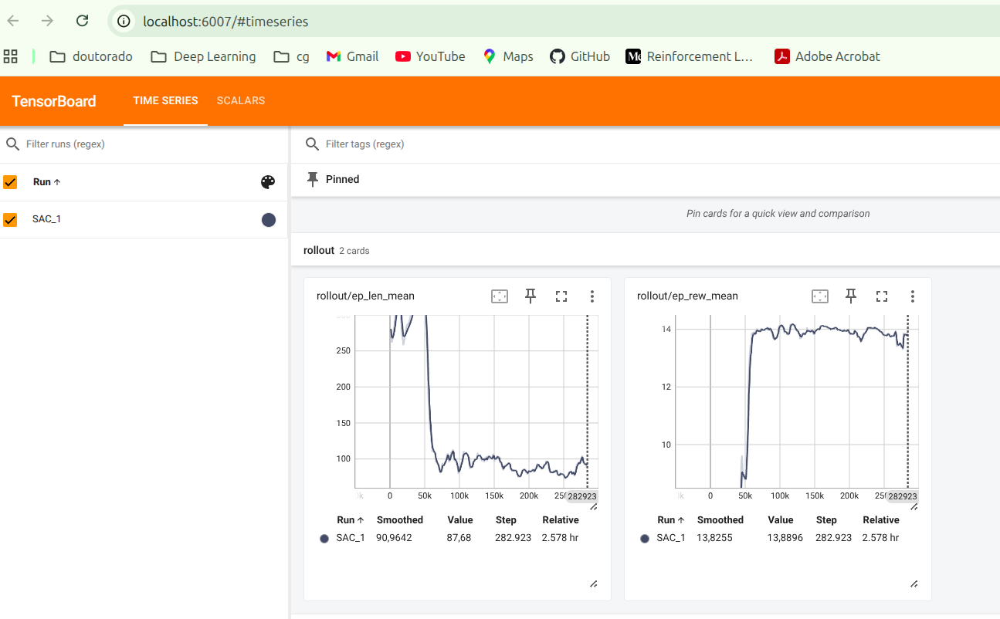

Com certeza. Aqui está o código Markdown completo do documento que melhorei para você.

Você pode copiar e colar este bloco de texto diretamente em um arquivo `.md`.

````markdown
# Introdução à AI4U

## Visão Geral

A versão mais recente da AI4U introduz o conceito de *templates de treinamento*. Atualmente, oferecemos templates baseados no algoritmo SAC da `stable-baselines3`. Em breve, expandiremos o suporte para o algoritmo *Proximal Policy Optimization (PPO)*.

O objetivo de um template é simplificar o processo de treinamento, eliminando a necessidade de escrever um script Python do zero, desde que você utilize um framework e uma estrutura de dados compatíveis.

Por exemplo, se você utiliza o algoritmo SAC implementado na `stable-baselines3` e os sensores do seu agente na Godot, via AI4U, geram um vetor de observação no formato `(N,)` (onde `N` é o número de entradas do modelo), o template assume que uma arquitetura do tipo *Multi-Layer Perceptron (MLP)* será utilizada. Nesse cenário, para treinar seu agente, basta executar o seguinte comando:

```bash
python -m ai4u_ml.sb3_sac_trainer --policy=MlpPolicy # Em algumas configurações Linux, use python3.
````

Da mesma forma, se o seu agente utiliza um sensor do tipo `Camera3DSensor` ou `Camera2DSensor`, a política recomendada é a `CnnPolicy`:

```bash
python -m ai4u_ml.sb3_sac_trainer --policy=CnnPolicy # Em algumas configurações Linux, use python3.
```

Por fim, para agentes com múltiplos tipos de entrada (como imagens e dados vetoriais), utilize a `MultiInputPolicy`:

```bash
python -m ai4u_ml.sb3_sac_trainer --policy=MultiInputPolicy # Em algumas configurações Linux, use python3.
```

Os comandos acima utilizam configurações padrão de parâmetros e arquiteturas de rede que são eficazes em cenários simples. É possível customizar parâmetros como o número de camadas, a quantidade de neurônios por camada e a taxa de aprendizado, passando-os como argumentos na linha de comando.

No entanto, para cenários mais complexos, como a criação de uma arquitetura de rede neural customizada, é necessário criar um script Python próprio. Isso dependerá das funcionalidades oferecidas pelo framework subjacente (neste caso, o `stable-baselines3`). Disponibilizamos tutoriais que demonstram o uso da AI4U em baixo nível:

  * [Introdução - Baixo Nível](https://www.google.com/search?q=lowlevel_introductionPTBR.md)

## Componentes Pré-Fabricados (Prefabs)

Além dos templates de treinamento, a versão atual da AI4U adiciona componentes pré-fabricados (prefabs) para facilitar seus primeiros passos com a ferramenta.

No diretório `addons/ai4u/prefabs/3d/agents`, você encontrará três templates de agentes pré-configurados para perseguir um alvo na cena. Todos funcionam de maneira similar, diferenciando-se apenas pelo tipo de sensor que utilizam. No script do agente, é necessário especificar o alvo (`Goal`) e as opções de respawn (`Respawn Options`), que definem as localizações onde o agente deve surgir no início ou após um reset do ambiente.

Os templates disponíveis são:

  * **`SingleGoalCnnPolicyAgent.tscn`**: Permite que o agente observe o ambiente através de uma câmera de baixa resolução (gerando uma sequência de 4 imagens de 61x61 pixels). Treinável com `CnnPolicy`.
  * **`SingleGoalMlpPolicyAgent.tscn`**: Permite que o agente perceba o ambiente por meio de *raycasting*, que resulta em uma matriz com códigos de objetos e distâncias. Treinável com `MlpPolicy`.
  * **`SingleGoalMultiInputAgent.tscn`**: Combina observações visuais (imagens) com dados vetoriais (como a posição atual do agente e a distância relativa ao alvo). Treinável com `MultiInputPolicy`.

Disponibilizamos também uma cena de exemplo, `Simple3DScene.tscn`, que contém um piso e caixas pré-fabricadas. Você pode arrastar um dos agentes para esta cena e iniciar o treinamento para observar o processo de aprendizagem.

# Exemplo Prático

Vamos configurar e treinar um agente.

1.  **Criação do Projeto**: Crie um novo projeto na Godot.
2.  **Instalação do Add-on**: Baixe a versão mais recente da AI4U. Descompacte o arquivo e copie os diretórios `addons/ai4u` e `addons/ai4u_prefabs3d` para a raiz do seu novo projeto Godot.
3.  **Abertura da Cena**: No editor da Godot, abra a cena de exemplo localizada em `addons/ai4u/dotnet/prefabs/3d/scenes/Simple3DScene.tscn`. A cena exibe um cubo azul e um cubo rosa sobre um plano verde.
4.  **Adição do Agente**: Arraste o prefab `SingleGoalMlpPolicyAgent.tscn` (localizado em `addons/ai4u/prefabs/3d/agents`) para a cena, posicionando-o sobre o plano verde.
5.  **Compilação do Projeto**: Com o cenário montado, é preciso compilar o projeto C\#. Acesse o menu **Project \> Tools \> C\#** e selecione **Create C\# solution**. Em seguida, clique no ícone de martelo (Build) no canto superior direito do editor.
6.  **Configuração do Agente**: Agora, vamos configurar o agente para que ele saiba qual é o seu objetivo.
      * Selecione o nó do agente no painel **Scene** (geralmente nomeado `Agent`).
      * No painel **Inspector** (à direita), localize a propriedade `Goal`. Arraste o nó do cubo rosa (ou outro objeto) do painel **Scene** para este campo.
      * Localize a propriedade `Respawn Options`. Arraste o nó `respawn` do painel **Scene** para este campo. Isso define onde o agente irá reaparecer.

Após essas configurações, você pode iniciar o treinamento a partir do seu terminal:

```bash
python -m ai4u_ml.sb3_sac_trainer --policy=MlpPolicy # Em algumas configurações Linux, use python3.
```

É possível passar outros argumentos de linha de comando compatíveis com a `stable-baselines3`. Para ver todas as opções disponíveis, execute:

```bash
python -m ai4u_ml.sb3_sac_trainer --help
```

Por exemplo, um argumento útil é o `--timesteps`, que limita a duração total do treinamento. Para este caso, 60.000 passos são suficientes:

```bash
python -m ai4u_ml.sb3_sac_trainer --policy=MlpPolicy --timesteps=60000
```

## Monitorando o Treinamento com TensorBoard

Para monitorar o progresso do treinamento (em tempo real ou após a conclusão), execute o seguinte comando no mesmo diretório:

```bash
tensorboard --logdir .
```

Siga as instruções exibidas no terminal para acessar a interface web do TensorBoard. Você poderá visualizar gráficos que mostram a performance do agente, como o de recompensa média, semelhante à imagem abaixo:


.